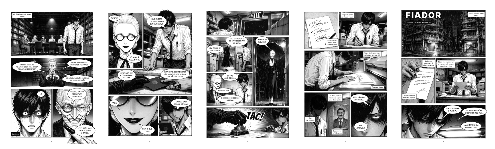

# FIADOR — Capítulo 1: *Firma Reconhecida*

Mangá original, seinen de jogo psicológico, em preto e branco. São as primeiras 5 páginas.

> **Leitura da direita para a esquerda**, como num mangá japonês: em cada página,
> comece pelo quadro do canto superior direito e, dentro de cada quadro, leia os
> balões de cima para baixo e da direita para a esquerda.

| Página | Arquivo |
|---|---|
| 1 | [`paginas/pagina_01.png`](paginas/pagina_01.png) |
| 2 | [`paginas/pagina_02.png`](paginas/pagina_02.png) |
| 3 | [`paginas/pagina_03.png`](paginas/pagina_03.png) |
| 4 | [`paginas/pagina_04.png`](paginas/pagina_04.png) |
| 5 | [`paginas/pagina_05.png`](paginas/pagina_05.png) |
| Capítulo inteiro em PDF | [`paginas/FIADOR_capitulo_01.pdf`](paginas/FIADOR_capitulo_01.pdf) |



## A premissa

No Brasil, *fiador* é quem assina garantindo a dívida de outra pessoa. Se o devedor
some, a conta é do fiador.

**Benedito "Dito" Saraiva**, 21 anos, trabalha de madrugada numa copiadora no centro de
São Paulo. Uma noite, chega um contrato: ele é fiador de uma dívida de
**R$ 4,7 milhões**. A assinatura é dele, mas ele nunca assinou aquilo.

Dito sabe que a assinatura é falsa por um detalhe que só um falsário perceberia:
*ninguém assina igual duas vezes*, e aquela é idêntica, traço por traço, à do RG dele.
Só duas pessoas no mundo copiam uma firma desse jeito: ele mesmo e o pai dele, um
escrevente de cartório condenado por falsificação, que morreu há três anos.

À meia-noite, uma escrevente do **13º Tabelionato de Notas**, um cartório que não
existe em nenhum registro, leva Dito até o jogo. Ali, seis fiadores disputam seis
dívidas que não são deles. **Regra única: ao amanhecer, cada dívida terá um único
fiador.** Quem sair com a firma limpa sai livre. Quem ficar com as dívidas paga
"com o que tiver".

E o anfitrião do jogo sabe exatamente quem Dito é.

## Personagens

| | |
|---|---|
| **Dito (Benedito Saraiva)** | 21 anos, alto e curvado. Cabelo preto com franja cortada em casa, olheiras fundas, cicatriz na sobrancelha esquerda. Usa camisa social branca com mangas dobradas, uma gravata fina e frouxa herdada do pai e uma caneta-tinteiro no bolso. Os dedos indicador e médio da mão direita vivem manchados de tinta, e por isso ele sempre tem uma mancha de tinta no queixo. Ex-falsário que jurou nunca mais copiar uma assinatura. |
| **A Escrevente** | Mulher alta, muito pálida, cabelo platinado preso num coque atravessado por duas canetas, óculos redondos de lentes pretas, batom escuro. Usa luvas longas pretas e leva um carimbo de cartório de latão pendurado numa corrente. Fala como quem lê um documento. |
| **O Tabelião** | Idoso esquelético, com cabelo prateado penteado para trás, uma lupa de joalheiro presa no olho direito como monóculo e um sorriso largo demais. Terno risca-de-giz de três peças. As pontas dos dez dedos são pretas de tinta, como as de Dito, só que muito piores. |

A folha de design dos três está em [`arte/referencia/folha_de_personagens.png`](arte/referencia/folha_de_personagens.png).

## Roteiro do capítulo (resumo por página)

1. **Centro de São Paulo, 23h47, chuva.** Dito lê o contrato. *"Dizem que a assinatura é a coisa mais pessoal que alguém tem. Bobagem. Assinatura é só um desenho. E todo desenho pode ser copiado."*
2. Dito assina três vezes num rascunho, e as três saem diferentes. Na luz da copiadora, a assinatura do contrato coincide exatamente com a do RG. *"Isso não foi assinado... Foi copiado."* Na parede, a foto do pai.
3. O sino da porta toca. A Escrevente entra: *"Vim tratar da sua fiança."* Ela carimba o contrato: **TAC!** Firma reconhecida.
4. *"Não existe 13º Tabelionato em São Paulo." / "Existe. Só abre à meia-noite."* Ela entrega um cartão preto lacrado. *"E quem sair com as dívidas?" / "Paga. Com o que tiver."*
5. **00h00.** Um arquivo colossal, cinco desconhecidos à mesa e o Tabelião. *"Gostou da sua assinatura, Benedito? Levei três anos para acertar o traço."*

## Como foi feito

- **Arte:** gerada com o **Higgsfield** (modelo Seedream 5.0 Flash), a partir de um roteiro e de um layout de quadros escritos para cada página, usando a folha de personagens como referência para manter os personagens consistentes. As direções de arte pedem traço de pena G, retícula mecânica, hachura e pretos chapados, inspiradas no clima de mangás de jogos psicológicos como *Liar Game* e *Tomodachi Game*. Os personagens, a história e o visual são originais.
- **Retoques:** a arte é convertida para P&B puro. Uma placa com ideogramas na rua foi trocada por "CHAVEIRO". O texto falso que a IA desenhou no contrato foi apagado e substituído por um contrato real em português. O quadro 1 da página 3 foi regerado, porque o Dito aparecia de jaqueta em vez da camisa branca.
- **Letreiramento:** todo o texto (balões, recordatórios, onomatopeias, título) é desenhado por código em [`tools/letreiramento.py`](tools/letreiramento.py), nunca pela IA. Assim não há erro de ortografia nem letras inventadas. Fontes: Comic Neue (falas e narração), Bangers (onomatopeias) e Inter Display (título), todas com licença SIL Open Font License.

### Refazer as páginas

```bash
pip install pillow
python3 tools/letreiramento.py        # gera paginas/*.png, o PDF e a visão geral
python3 tools/letreiramento.py 3      # só a página 3
```

A arte crua, sem texto, fica em `arte/bruto/`. Para mudar uma fala, edite a função
`pagina_N` correspondente em `tools/letreiramento.py`.
